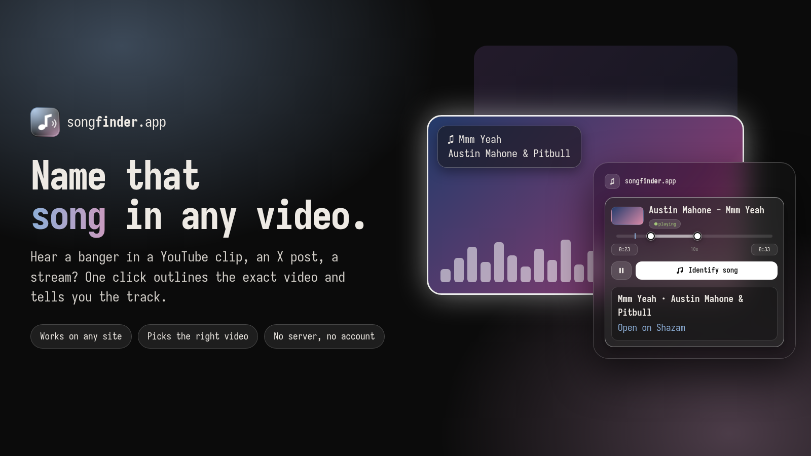

<p align="center">
  
</p>

<h1 align="center">songfinder.app</h1>

<p align="center">
  Name the song in any video.<br>
  A browser extension for Brave, Chrome, Edge and Firefox.
</p>

<p align="center">
  <a href="https://valvesky.github.io/songfinder.app/">Website</a>
  ·
  <a href="#install">Install</a>
  ·
  <a href="#how-it-works">How it works</a>
  ·
  <a href="PRIVACY.md">Privacy</a>
</p>

<p align="center">
  
</p>

## Features

- **A button on every video.** A small glass badge sits in the top-right corner. One click names the song. Switch it off from the popup.
- **Knows which video.** The video it will listen to gets outlined, so it's never a guess on a page with many videos. Hover a card in the popup to see which one is which.
- **Starts the video for you.** Paused or muted? It plays, unmutes, listens, then puts things back.
- **Pick the part to listen to.** Drag the two dots on the timeline, or type the start and end times.
- **Skips GIFs.** Videos without an audio track (Tenor, Discord, MP4 "GIFs") are ignored.
- **No server, no account.** Everything runs in the extension. Only a small audio fingerprint is sent for lookup.

## Install

Not on the stores yet. Load it unpacked:

**Brave / Chrome / Edge**

1. Open `brave://extensions` (or `chrome://extensions`) and turn on **Developer mode**.
2. **Load unpacked** and pick the `extension/` folder.

**Firefox**

1. Run `tools/build.sh`.
2. Open `about:debugging` → **This Firefox** → **Load Temporary Add-on** and pick `dist/firefox/manifest.json`.

## How it works

1. The content script lists every `<video>` (iframes and shadow DOM included) and puts a badge on each one that has sound.
2. Clicking a badge, or **Identify song** in the popup, starts the video if needed and records the chosen segment (10 seconds by default, 3–30 selectable) with `captureStream`.
3. The audio is decoded to 16 kHz mono and turned into a Shazam signature in plain JavaScript (`extension/lib/shazam.js`, a port of the open signature algorithm, checked against [`shazamio`](https://github.com/shazamio/ShazamIO)). The background worker looks it up.

## Develop

```sh
node test/shazam.test.mjs some-song.opus      # fingerprint + lookup from a file
node test/e2e.mjs <dir-with-index.html>       # real Chromium with the extension loaded
node test/popup.mjs <dir> <out-prefix>        # drives the popup UI, segment picker included
node test/silent.mjs <dir> <shot.png>         # silent videos must be ignored
tools/build.sh                                # dist/songfinder-{chrome,firefox}-<version>.zip
node tools/promo.mjs                          # X card + store screenshot
```

The website is a plain static page in [`docs/`](docs), served by GitHub Pages (Settings → Pages → Deploy from branch → `/docs`).

## Limitations

- The video must be able to play. DRM or cross-origin media without CORS may expose no audio.
- Recognition uses Shazam's unofficial endpoint, which can change or be rate limited. Store reviewers may object to it; see [`store/listing.md`](store/listing.md).
- The Firefox build is generated but not yet tested in Firefox.
- Not affiliated with Shazam. "Shazam" is a trademark of its owner.
